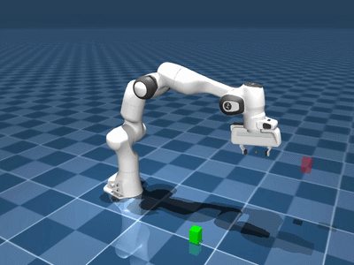
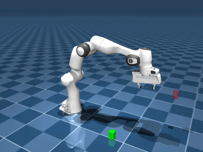

# CSCI 645 Homework 2: Imitation Learning for Robot Manipulation

**Deadline:** Friday October 30, 11:59 PM Pacific Time  

**Submission:** One ZIP file on Brightspace with your code and the writeup

**Framework:** this homework will use [MuJoCo Playground](https://github.com/google-deepmind/mujoco_playground)


Changelog:

- 10/09/2026: initial release.


## Overview

In Homework 1, you investigated reinforcement learning for robot manipulation. In Homework 2, you will investigate **imitation learning**: training a robot policy from demonstrations. You will study:

> **How does demonstration quality or quantity affect imitation learning performance?**

Your goals are to:

1. Obtain and visualize robot manipulation demonstrations.
2. Train an imitation learning policy using **Action Chunking with Transformers (ACT)** or **Diffusion Policy**.
3. Evaluate its behavior in simulation.
4. Perform one controlled experiment that changes the demonstration dataset.
5. Analyze your results and submit reproducible code.

**No starter implementation is provided.** You may build on publicly available code (with citations), but you are responsible for integrating the environment, demonstration collection, dataset loading, training, and evaluation.

## Part 0: Environment and setup

Use [MuJoCo Playground](https://github.com/google-deepmind/mujoco_playground). We recommend the **`PandaPickCube`** manipulation environment. *You may use a different MuJoCo Playground manipulation task, just please make it clear what you choose.*

Useful starting points:

- [MuJoCo Playground repository and installation instructions](https://github.com/google-deepmind/mujoco_playground)
- [MuJoCo Playground PPO training script](https://github.com/google-deepmind/mujoco_playground/blob/main/learning/train_jax_ppo.py)
- [ACT paper](https://arxiv.org/abs/2304.13705)
- [Diffusion Policy paper](https://arxiv.org/abs/2303.04137)

Use **state-based observations** for the required experiments. If you prefer to use image inputs, that's also fine (just specify that you did this in your writeup). Specify your observation and action representations, any normalization, and how action predictions are executed in the simulator.

Report your hardware, major library versions, and random seeds. You are responsible for resolving installation and implementation issues; note any significant deviations from the upstream code. I use an Ubuntu 22.04 system with CUDA 12.4. 


### PandaPickCube Environment Visualization

The following GIFs illustrate the `PandaPickCube` environment in MuJoCo Playground, using a Franka Panda robot.

<table>
  <tr>
    <th>Zero actions</th>
    <th>Random actions</th>
  </tr>
  <tr>
    <td></td>
    <td></td>
  </tr>
</table>


<details>
<summary><b>This is the code that I ran to generate the one with random actions and to save the video.</b></summary>

The following Python script generates a rollout with random actions
in the `PandaPickCube` environment and saves it as an MP4 video.

```python
import os
os.environ["MUJOCO_GL"] = "egl"

import jax
import jax.numpy as jnp
import mediapy as media

from mujoco_playground import registry

# Load PandaPickCube using the JAX backend.
env = registry.load(
    "PandaPickCube",
    config_overrides={"impl": "jax"},
)

# Initialize the environment.
reset_fn = jax.jit(env.reset)
step_fn = jax.jit(env.step)

state = reset_fn(jax.random.PRNGKey(0))
trajectory = [state]

rng = jax.random.PRNGKey(42)
action = jnp.zeros(env.action_size)

# Run the simulation with random actions.
for i in range(200):
    if i % 10 == 0:
        rng, action_rng = jax.random.split(rng)
        action = jax.random.uniform(
            action_rng,
            shape=(env.action_size,),
            minval=-1.0,
            maxval=1.0,
        )

    state = step_fn(state, action)
    trajectory.append(state)

# Render the simulation.
print("Rendering video...")
frames = env.render(trajectory[::2], height=480, width=640)

# Save as an MP4.
media.write_video(
    "panda_pick_cube.mp4",
    frames,
    fps=round(1.0 / env.dt / 2),
)

print("Saved panda_pick_cube.mp4")
```

To reproduce the "zero action" rollout, replace the "random action" generation with:

```python
action = jnp.zeros(env.action_size)
```

at every simulation step.

</details>


For this homework, your objective is to collect demonstrations of successful manipulation and train an imitation learning policy.


## Part 1: Collect demonstrations

Obtain a **baseline dataset of approximately 100 demonstration trajectories** using one of these approaches:

- **RL teacher:** Train a reinforcement learning policy (such as PPO) or use an existing compatible checkpoint, then record its observations and actions while executing the policy.
- **Scripted expert:** Implement a scripted, heuristic, or motion planning controller, then record its observations and actions.

Store enough information to train a policy and reproduce your dataset: observations, actions, episode boundaries, and success/failure labels. Include rewards or other useful diagnostics when available. Make sure each stored action matches the observation from which it was selected.

### Visualize and inspect the data

Include:

- At least one video showing an expert demonstration.
- A figure or series of frames illustrating several demonstrations.
- The number of trajectories, mean and standard deviation of trajectory length, and fraction of successful trajectories in the collected dataset.
- A short discussion of demonstration consistency, coverage of initial conditions, and apparent errors or inefficiencies.

## Part 2: Train an imitation learning policy

Choose **one** algorithm for this homework:

- **ACT (Action Chunking with Transformers):** Predict action chunks using a transformer-based imitation learning policy.
- **Diffusion Policy:** Predict action sequences with a conditional denoising model.

You may adapt an open-source implementation. Cite the source, explain what you changed, and provide sufficient code and configuration to reproduce your results. You do **not** need to implement the algorithm from scratch.

Train your chosen policy on your baseline demonstration dataset. Record:

- Observation/action dimensions and representations.
- Model architecture and action horizon/chunk length.
- Training objective, optimizer, learning rate, batch size, and training duration.
- Any observation/action normalization or data preprocessing.
- At least one training loss curve and the random seed(s) used.

We recommend using Weights & Biases or another logging system. Include links if applicable, but please make the report readable / understandable *without* me needing to do external logins. 

## Part 3: Demonstration data experiment

Run **one controlled ablation** with the **same imitation learning algorithm**. At minimum, compare the baseline policy against **one additional trained policy**. Keep other training and evaluation settings as consistent as possible.

Choose one of the following (or propose a comparable experiment):

### Option A: Dataset quantity 

Compare training with approximately **25 versus 100 demonstration trajectories**. Optionally add an intermediate dataset size (such as 50). Select the smaller dataset as a subset of the full baseline dataset so the comparison is interpretable.

### Option B: Noisy demonstrations

Collect a second dataset while introducing controlled noise into the teacher's actions **during environment interaction**. Document where the noise is applied, its scale, and whether actions are clipped to valid bounds. Report how the noise changes teacher success and the resulting student success.

### Option C: Teacher quality

Collect data from teachers of different competence (for example, PPO checkpoints at different stages of training). Report each teacher's evaluation success rate. Explain whether failed trajectories are included and how you control dataset size.

### Option D: Other hypothesis

You may pursue another meaningful study of demonstration quality or quantity. Clearly define the independent variable and keep other settings fixed.

## Part 4: Evaluate and analyze

Evaluate **each trained student policy** on **at least 50 held-out environment initializations**, preferably using the same evaluation seeds across conditions. Do not evaluate by replaying training trajectories. Note that here the "teacher" is the same as the demonstrator / expert, as discussed in class.

Report at least:

| Condition | Number of demonstrations | Teacher success rate | Student success rate | Evaluation episodes |
|---|---:|---:|---:|---:|
| Baseline | ... | ... | ... | >= 50 |
| Ablation | ... | ... | ... | >= 50 |

Provide representative policy rollout videos, including a success and a failure when available. Identify at least one interesting failure mode (e.g., grasp errors, oscillatory actions). 

Discuss what your comparison suggests, including limitations. A negative result is acceptable if the experiment is reproducible and the analysis is thoughtful. 

## Submission

Submit a **single ZIP archive** to Brightspace named `LASTNAME_FIRSTNAME_HW2.zip`. Include **all self-authored or modified code**, configuration files, evaluation results, report, and representative videos. For the sake of my sanity, please do not package entire third-party libraries. Instead, please document the precise versions/commits and installation steps.

Here is one possible layout, with your `report.pdf` there:

```text
LASTNAME_FIRSTNAME_HW2/
├── report.pdf
├── README.md                 # How to reproduce experiments
├── code/                     # Collection, training, and evaluation code
├── configs/                  # Exact configurations and seeds
├── results/                  # CSV/JSON summary, loss curves, plots
└── videos/                   # Expert and student rollouts
```

If raw demonstrations or checkpoints are too large for the ZIP, provide scripts and precise instructions to regenerate them, or durable accessible links. The submission must be self-contained in **code and instructions** even when large data files are linked externally. Check that the ZIP opens and that it does not contain secrets or API keys.

### Questions to answer in `report.pdf`

1. **Task and demonstration source.** Which environment and teacher did you use? How were demonstrations generated? What was the teacher's success rate (and did you filter the data)?
2. **Demonstration quality.** How many episodes were collected, how long were they, and how many succeeded? Show a figure and a demonstration video. What did you observe?
3. **Policy and training.** Did you choose ACT or Diffusion Policy? Describe inputs/outputs, the training objective, chunk/prediction horizon, training configuration, and loss curves.
4. **Baseline results.** What is the baseline policy's task success rate over at least 50 episodes? Show representative rollouts.
5. **Data ablation.** What did you vary, why, and what was the result? Provide a comparison table or plot and explain.
6. **Failure analysis.** Identify and analyze a failure mode, relating it where appropriate to concepts discussed in class.
7. **Reproducibility and reflection.** Provide commands, configurations, seeds, and relevant links. What would you improve with more data, compute, or engineering time?
8. **Citations.** Clarify what resources you used for the homework. If you used LLMs, how did you use them?

**Grading emphasis:** Correctness, reproducibility, thoughtful experiment design, and analysis. Getting the highest raw task success rate is OK but this is not really the main thing I want you to learn from this assignment. 
